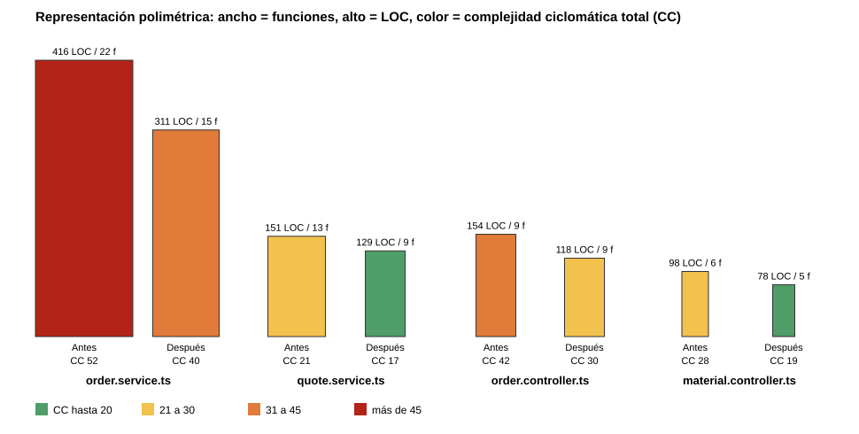

# Métricas del software

Las dos mediciones usan las mismas herramientas, alcance y configuración, descritos en [EVALUACION_SOFTWARE.md](EVALUACION_SOFTWARE.md). Los datos están en `docs/evidencias/antes/resumen.json` y `docs/evidencias/despues/resumen.json`.

## Comparación del proyecto completo

| Métrica | Antes | Después | Variación |
|---|---:|---:|---:|
| Líneas de código (LOC) | 13725 | 13689 | −36 (−0.3 %) |
| Archivos fuente | 75 | 86 | +11 (+14.7 %) |
| Complejidad ciclomática promedio | 3.03 | 2.95 | −0.08 |
| Complejidad ciclomática total | 2535 | 2510 | −25 |
| Complejidad máxima | 157 | 157 | 0 |
| Duplicación | 0.74 % | 0.59 % | −0.15 puntos |
| Problemas de calidad | 96 | 84 | −12 |
| Problemas de diseño | 116 | 111 | −5 |
| Incumplimientos de estándares | 179 | 132 | −47 |
| Posibles vulnerabilidades en código | 55 | 54 | −1 |
| Dependencias vulnerables | 8 | 8 | 0 |
| Deuda técnica estimada (propia) | 116.4 h | 107.5 h | −8.9 h |

## Comparación del backend (parte intervenida)

| Métrica | Antes | Después | Variación |
|---|---:|---:|---:|
| Líneas de código (LOC) | 2112 | 2076 | −36 (−1.7 %) |
| Archivos fuente | 39 | 50 | +11 (+28.2 %) |
| Funciones | 111 | 127 | +16 |
| Complejidad ciclomática promedio | 2.90 | 2.34 | −0.56 (−19.3 %) |
| Complejidad ciclomática total | 322 | 297 | −25 (−7.8 %) |
| Complejidad máxima | 11 | 9 | −2 |
| Funciones de complejidad baja (1 a 5) | 95 | 119 | +24 |
| Funciones moderadas (6 a 10) | 15 | 8 | −7 |
| Funciones altas (11 a 20) | 1 | 0 | −1 |
| Funciones muy altas (más de 20) | 0 | 0 | 0 |
| Líneas duplicadas | 43 | 22 | −21 |
| Duplicación | 1.73 % | 0.89 % | −0.84 puntos |
| Problemas de calidad | 12 | 0 | −12 (−100 %) |
| Problemas de diseño | 7 | 2 | −5 |
| Incumplimientos de estándares | 54 | 7 | −47 (−87.0 %) |
| Posibles vulnerabilidades en código | 4 | 3 | −1 |
| Dependencias vulnerables (npm audit) | 7 | 7 | 0 |
| Deuda técnica estimada (propia) | 12.0 h | 3.1 h | −8.9 h |

El frontend no se modificó y sus valores son iguales en ambas mediciones.

Fórmula de duplicación: líneas duplicadas / líneas analizadas × 100.
- Antes: 43 / 2484 × 100 = 1.73 %
- Después: 22 / 2472 × 100 = 0.89 %

## Representación polimétrica

Ancho: número de funciones. Alto: líneas de código. Color: complejidad ciclomática total.

| Componente | LOC | Funciones | CC total | CC máxima | Dependencias salientes | Hallazgos |
|---|---:|---:|---:|---:|---:|---:|
| `order.service.ts` antes | 416 | 22 | 52 | 8 | 2 | 5 |
| `order.service.ts` después | 311 | 15 | 40 | 9 | 6 | 0 |
| `quote.service.ts` antes | 151 | 13 | 21 | 3 | 2 | 1 |
| `quote.service.ts` después | 129 | 9 | 17 | 3 | 4 | 1 |
| `order.controller.ts` antes | 154 | 9 | 42 | 7 | 4 | 13 |
| `order.controller.ts` después | 118 | 9 | 30 | 6 | 5 | 0 |
| `material.controller.ts` antes | 98 | 6 | 28 | 8 | 4 | 7 |
| `material.controller.ts` después | 78 | 5 | 19 | 6 | 4 | 0 |

`order.service.ts` era el archivo más grande y complejo del backend. Perdió 105 líneas y pasó de 5 hallazgos a 0. La liquidación de metal quedó en `metal.service.ts` (89 LOC, CC 13) y `balance-metal.ts` (23 LOC, CC 2).

## Interpretación

- **Más archivos y funciones:** es el efecto esperado de separar responsabilidades. Hay más piezas, pero más pequeñas.
- **Complejidad:** baja en promedio y el backend ya no tiene funciones de nivel alto.
- **Estándares:** la mayor reducción viene de quitar los `catch (error: any)` de los controladores.
- **Duplicación:** quedan dos bloques, que son las relaciones `include` de consultas Prisma en `order.service.ts`.

### Lo que no mejoró

- **Complejidad máxima de `order.service.ts`:** subió de 8 a 9. `updateOrderStatus` ahora también valida la secuencia de estados.
- **Dependencias salientes de `order.service.ts`:** subieron de 2 a 6, porque usa los nuevos módulos del dominio.
- **LOC:** casi no cambió. Se eliminó código repetido, pero se agregaron interfaces y validaciones.
- **Dependencias vulnerables:** no se actualizaron, porque es una tarea de mantenimiento aparte.
- **Frontend:** conserva la complejidad máxima de 157 en `OrderDetailModal.tsx`.

## Métricas no obtenidas con herramienta

- **Deuda técnica:** ninguna herramienta usada la entrega. Se presenta una estimación propia con el mismo criterio antes y después.
- **Cobertura de pruebas:** no la pide la guía y no se midió.

## Conclusiones

1. El backend redujo su complejidad promedio 19.3 % y casi a la mitad su duplicación.
2. Los problemas de calidad del backend pasaron de 12 a 0 y los incumplimientos de estándares de 54 a 7.
3. Se corrigieron cinco defectos demostrados con pruebas.
4. La mayor deuda restante está en el frontend, sobre todo en `OrderDetailModal.tsx` y `QuoteBuilder.tsx`.
